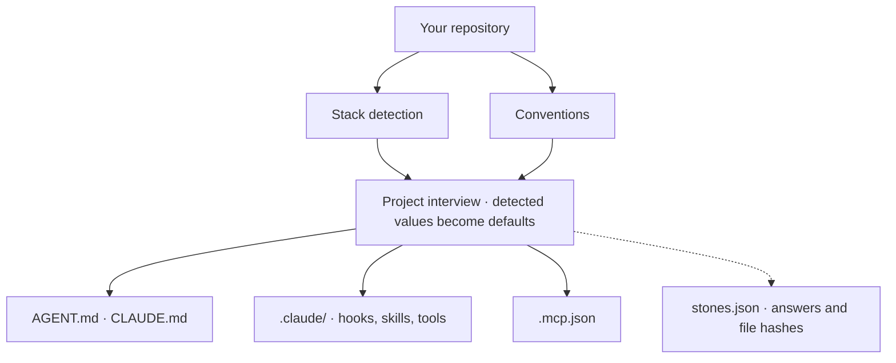

import AiStonesDiagram from '../../../components/diagrams/AiStonesDiagram.astro';

## Problem

Coding agents are only as good as the context they get. Most projects start Claude Code with no brief, generic permissions and none of the project's own commands, so every session rediscovers how to build, test and lint, and every team copies the same `.claude/` files by hand. AI Stones turns that setup into one command: `npx ai-stones init`.

## Constraints

- **Any stack**: it has to read what the project already is (languages, frameworks, package manager, monorepo tooling, test, lint, typecheck and build commands, formatters, commit style), not assume one.
- **Never clobber people's work**: teams edit generated files; a re-run must not overwrite them silently.
- **Small context**: everything loaded on every prompt costs tokens, so most guidance has to load only when a task needs it.
- **Zero install**: it runs with `npx` on Node.js 22.13 or newer, with no registry token.

## Architecture

<AiStonesDiagram>

Diagram source (Mermaid)

</AiStonesDiagram>

`init` detects the stack first (`npx ai-stones detect` prints it as JSON), asks only for what it cannot infer, such as purpose, architecture, security conventions, branching and TDD preferences, and which hooks, skills, plugins and MCP servers to include, then installs only what was selected: a short `AGENT.md` brief imported by `CLAUDE.md`, `.mcp.json`, and `.claude/` with settings, hooks, skills, slash commands such as `/roadmap`, and project tools.

## Key decisions

1. **Guides as skills, not one big prompt.** Putting every guide in `CLAUDE.md` would load all of it on every prompt. `CLAUDE.md` imports a short `AGENT.md`; the rest is installed as Claude Code skills, whose full instructions load only when a task matches.
2. **Safe to re-run, by hashing what it wrote.** Overwriting on every run would destroy edits; refusing to touch existing files would freeze the setup. `stones.json` stores the answers and a hash of every installed file, so a re-run updates unedited files, preserves and reports edited ones, and merges settings. `--force` is the explicit opt-out.
3. **Settings from the actual project.** Permissions and sandbox domains follow the detected commands and ecosystems, and framework plugins are offered only when relevant, instead of a permissive default that fits nobody.
4. **Guardrails on by default, process opt-in.** Lightweight guardrails, atomic-commit protection and a workflows hook are selected by default. That hook blocks merges, package publishes and releases until a full local CI run has passed for the current code. Heavier process gates, history recording and the code graph are opt-in.
