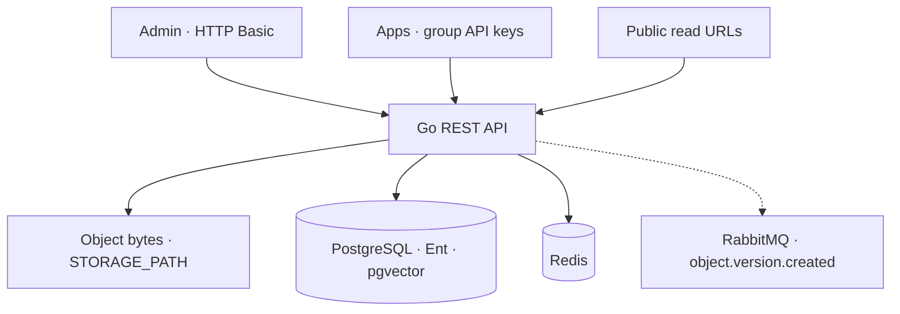

import ArchioDiagram from '../../../components/diagrams/ArchioDiagram.astro';

## Problem

archio started as a way to understand object storage from the inside: how files are processed and stored, how delivery is optimised, and what it takes to run storage on several nodes for high availability. Rather than reading about S3, it builds a storage service small enough to reason about end to end.

## Constraints

- **Plain HTTP and JSON**: a REST API with no visual interface, deliberately not S3-compatible.
- **Never lose a version**: every upload creates a new immutable version.
- **Tenant isolation**: keys belong to one group and must never see another group's buckets.
- **Shareable reads**: a version must be downloadable without a key, without exposing anything else.

## Architecture

<ArchioDiagram>

Diagram source (Mermaid)

</ArchioDiagram>

Admin endpoints manage groups and API keys with HTTP Basic auth; the plaintext key is shown only once. Every other endpoint takes a group-scoped Bearer key: buckets, uploads, listings with prefix and cursor, and version history. The only public route is `GET /v1/objects/{versionId}`, which serves one version with `Range` and `If-None-Match` support. After each upload, archio publishes `object.version.created` on a durable RabbitMQ topic exchange, and `/health` reports readiness of PostgreSQL, Redis and RabbitMQ without leaking connection errors.

## Key decisions

1. **Immutable versions with one read URL each.** Mutable objects make caching and sharing ambiguous. Every upload is a new version with exactly one public URL, so a shared link always returns the same bytes and can be cached forever.
2. **Cross-group access returns 404, not 403.** A 403 would confirm that another group's bucket exists. Answering 404 keeps tenants invisible to each other.
3. **Events instead of synchronous side effects.** Indexing, thumbnails or replication should not slow uploads down. Publishing `object.version.created` lets other services react without the API waiting on them.

### What's next

- **Semantic search over stored files**, extracting text with Docling and storing embeddings in the PostgreSQL instance that already has pgvector enabled. {/* CHECK: not in the public repo yet; confirm status */}
- **A multi-node cluster for high availability**, replicating object bytes across nodes. {/* CHECK: not in the public repo yet; confirm status */}
