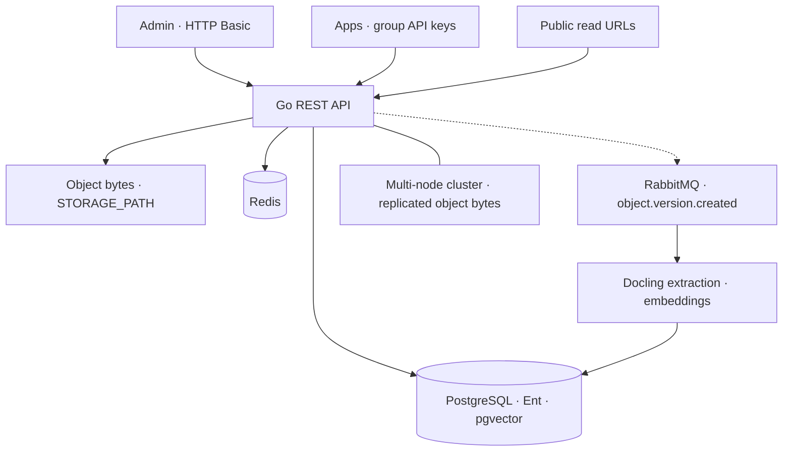

import ArchioDiagram from '../../../components/diagrams/ArchioDiagram.astro';

## Problem

archio started as a way to understand object storage from the inside: how files are processed and stored, how delivery is optimised, and what it takes to run storage on several nodes for high availability. Rather than reading about S3, it builds a storage service small enough to reason about end to end.

## Constraints

- **Plain HTTP and JSON**: a REST API with no visual interface, deliberately not S3-compatible.
- **Never lose a version**: every upload creates a new immutable version.
- **Tenant isolation**: keys belong to one group and must never see another group's buckets.
- **Shareable reads**: a version must be downloadable without a key, without exposing anything else.
- **Survive a node**: storage has to keep serving when one node goes down.
- **Find files by meaning**: stored documents should be searchable by what they say, not only by key.

## Architecture

<ArchioDiagram>

Diagram source (Mermaid)

</ArchioDiagram>

Admin endpoints manage groups and API keys with HTTP Basic auth; the plaintext key is shown only once. Every other endpoint takes a group-scoped Bearer key: buckets, uploads, listings with prefix and cursor, and version history. The only public route is `GET /v1/objects/{versionId}`, which serves one version with `Range` and `If-None-Match` support. After each upload, archio publishes `object.version.created` on a durable RabbitMQ topic exchange. Documents are processed with Docling, and their embeddings are stored in PostgreSQL with pgvector, which makes stored files searchable by meaning. Object bytes are replicated across the nodes of a multi-node cluster for high availability. `/health` reports readiness of PostgreSQL, Redis and RabbitMQ without leaking connection errors. {/* CHECK: describe how Docling extraction and cluster replication are wired */}

## Key decisions

1. **Immutable versions with one read URL each.** Mutable objects make caching and sharing ambiguous. Every upload is a new version with exactly one public URL, so a shared link always returns the same bytes and can be cached forever.
2. **Cross-group access returns 404, not 403.** A 403 would confirm that another group's bucket exists. Answering 404 keeps tenants invisible to each other.
3. **Events instead of synchronous side effects.** Text extraction, indexing and replication should not slow uploads down. Publishing `object.version.created` lets them run after the upload returns, without the API waiting on them. {/* CHECK: confirm extraction is event-driven */}
4. **Semantic search in the database that already holds the metadata.** A separate vector store would add another system to run and keep in sync. Storing Docling-derived embeddings in PostgreSQL with pgvector keeps search next to the version records it points to. {/* CHECK: confirm rationale */}
