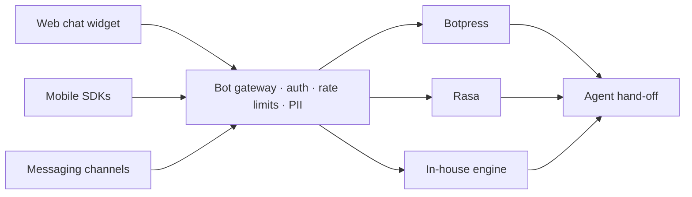

import LayerDiagram from '../../../components/diagrams/LayerDiagram.astro';

## Problem

A chatbot is one of the few parts of a product that anyone on the internet can talk to, without an account, at any volume. Clients wanted bots that answered real questions in their customers' languages, embedded in their own websites, apps and messaging channels, and handed off to an agent when needed. That meant choosing the right engine for each bot, building the backend and the chat UI around it, and securing an endpoint that is public by design.

## Constraints

- **Public by design**: the widget and its API are reachable by anyone, so every message is untrusted input and every endpoint can be scripted or flooded.
- **Different engines for different clients**: Botpress v12 across Qalqul's clients, and Rasa with an in-house engine for AtlantaSanad, an insurer.
- **Embedded everywhere**: the same bot runs in a web widget, mobile SDKs and messaging channels, and has to hand off to a human with the history intact.
- **Personal data in free text**: customers type card numbers, phone numbers and names into the chat whether asked to or not.

## Architecture

<LayerDiagram
  title="Public chatbots"
  desc="Web chat widgets, mobile SDKs and messaging channels reach one bot gateway. The gateway authenticates the widget, applies rate limits and abuse checks, and redacts personal data before routing each conversation to Botpress, Rasa or the in-house engine. Hand-off moves the conversation to an agent queue with its history."
  layers={[
    { caption: 'Entry (public)', nodes: [{ label: 'Web chat widget', sub: 'React' }, { label: 'Mobile SDKs' }, { label: 'Messaging channels' }] },
    { caption: 'Gateway', nodes: [{ label: 'Bot gateway', sub: 'auth · rate limits · PII', accent: true }] },
    { caption: 'Engines', nodes: [{ label: 'Botpress' }, { label: 'Rasa' }, { label: 'In-house engine' }, { label: 'Agent hand-off', sub: 'queues · history' }] },
  ]}
/>

Diagram source (Mermaid)

## Key decisions

1. **One gateway in front of every engine.** Widgets never talk to Botpress, Rasa or the in-house engine directly. The gateway owns authentication, limits and logging, so the security of a bot does not depend on which engine it runs on.
2. **Treat the widget as an untrusted client.** Widget tokens are scoped to one bot and one site and expire, messages are validated and size-limited, and requests are rate limited per session and per IP, so a scraped widget key cannot be used to flood or abuse the bot.
3. **Redact before anything is stored.** Card numbers, phone numbers and similar personal data are masked in transcripts before they reach logs, analytics or training data. Detection combines named-entity recognition with regular expressions and checksums.
4. **Guard the LLM-backed paths against prompt injection.** Where a bot calls a language model or tools, user text is kept separate from instructions, tools run with the conversation's own permissions, and actions that change data need explicit confirmation.
5. **Pick the engine per bot, keep the UI the same.** The React widget, the SDKs and the hand-off path are shared, so changing a bot's engine does not change what the customer sees.

The Botpress side is described in detail in [Botpress integration](/projects/qalqul-botpress).
