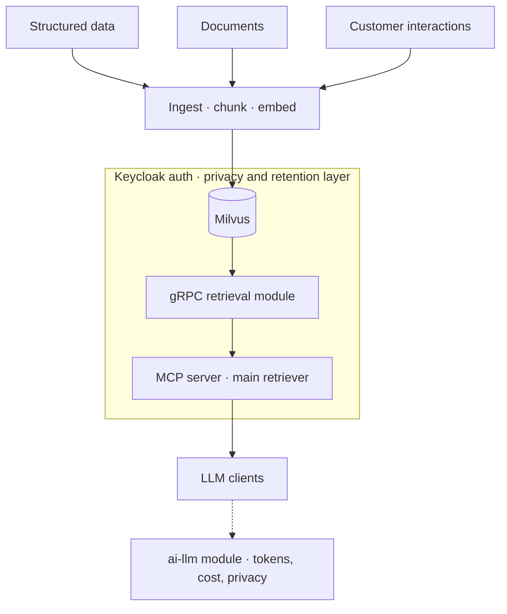

import CustomerVoiceDiagram from '../../../components/diagrams/CustomerVoiceDiagram.astro';

## Problem

What customers say about a business is spread across call transcripts, chats, tickets, documents and structured records. Teams want to ask questions of all of it, "why are refund complaints up this month?", and assistants and agents need the same context. Each consumer building its own retrieval would mean as many copies of customer data, and as many places to get access and retention wrong.

## Constraints

- **Mixed sources**: structured records, unstructured documents and customer interactions, including transcripts from the [Saudi-dialect speech-to-text](/projects/saudi-stt) model.
- **Many consumers**: chatbots, coding and analysis agents, and analysts, each with different permissions.
- **Privacy and retention**: government and enterprise clients, so every read is authenticated, and data expires on schedule.
- **Cost visibility**: LLM usage has to be measured per consumer.

## Architecture

<CustomerVoiceDiagram>

Diagram source (Mermaid)

</CustomerVoiceDiagram>

The pipeline ingests every source into one Milvus index. Retrieval lives in its own gRPC module, and an MCP server is the only way in: chatbots, agents and analysts all retrieve through it. Keycloak validates every request, and the privacy and retention layer decides what each caller may see and when data expires. The ai-llm module accounts for tokens, cost and privacy on the generation side.

## Key decisions

1. **MCP as the single retriever.** Embedding retrieval inside each app would have been quicker for the first consumer and wrong for the fifth: every copy is another access path to customer data. The main purpose was to separate retrieval from the apps and standardise how they reach it: MCP sits on top of the search queries, gRPC and HTTP calls, gives every client the same tools, and puts auth and retention in one place.
2. **Retrieval as a separate gRPC module.** Keeping retrieval out of the MCP server lets it scale and change independently, and keeps the MCP layer thin: tool definitions, auth and policy.
3. **Retention enforced at retrieval, not only at the source.** Deleting at the source does not remove embeddings already indexed. The retention layer filters and expires at the point of retrieval, so expired data stops being served even before the index is rebuilt.
