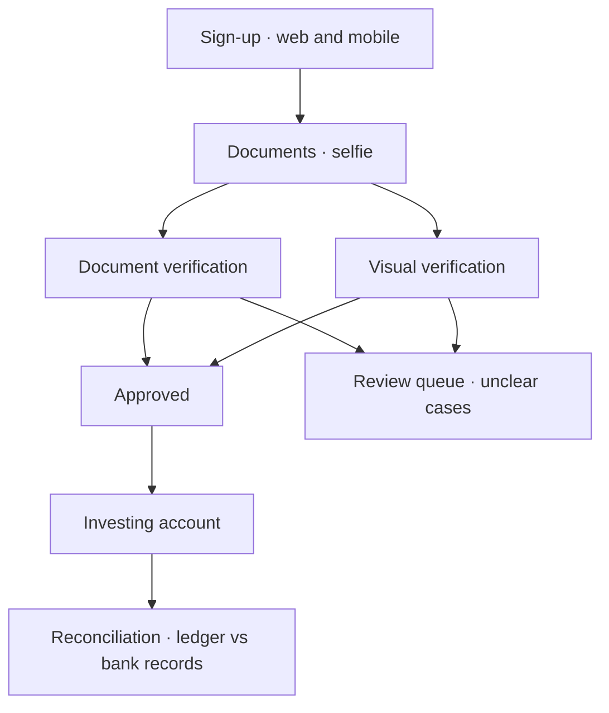

import Gallery from '../../../components/Gallery.astro';
import FinamazeKycDiagram from '../../../components/diagrams/FinamazeKycDiagram.astro';

## Problem

Finamaze runs a robo-advisor that builds AI-tailored portfolios for each investor's risk profile. Before anyone can invest, the platform has to know who they are, and once money moves, its own ledger has to agree with the bank's records to the cent. Both jobs used to depend on people checking documents and spreadsheets by hand. {/* CHECK: "to the cent" and the manual starting point are inferred */}

## Constraints

- **Regulated onboarding**: identity checks are a precondition for investing, for a platform serving Saudi National Bank. {/* CHECK: confirm regulatory framing */}
- **Two kinds of evidence**: the document itself and the person presenting it both need verifying.
- **Money must reconcile**: any difference between the platform's records and the bank's has to surface quickly, not at month end. {/* CHECK: cadence inferred */}
- **Privacy**: identity documents are among the most sensitive data a fintech holds.

## Architecture

<FinamazeKycDiagram> {/* CHECK: selfie, web and mobile sign-up, review queue are inferred */}

Diagram source (Mermaid)

</FinamazeKycDiagram>

<Gallery items={props.media} />

## Key decisions

1. **Document and visual verification as separate checks.** A valid document says nothing about who is holding it. Verifying the document and matching the person to it are separate steps with separate outcomes, so a failure says which one failed. {/* CHECK: confirm how the two checks were combined */}
2. **A review queue for unclear cases instead of automatic rejection.** Rejecting every borderline case loses real investors; approving them loses compliance. Unclear results go to a person with the evidence attached. {/* CHECK */}
3. **Reconciliation as a continuous job, not a month-end report.** Matching the platform's ledger against bank records on a schedule surfaces breaks while they are still small and explainable. {/* CHECK: confirm cadence and sources */}
