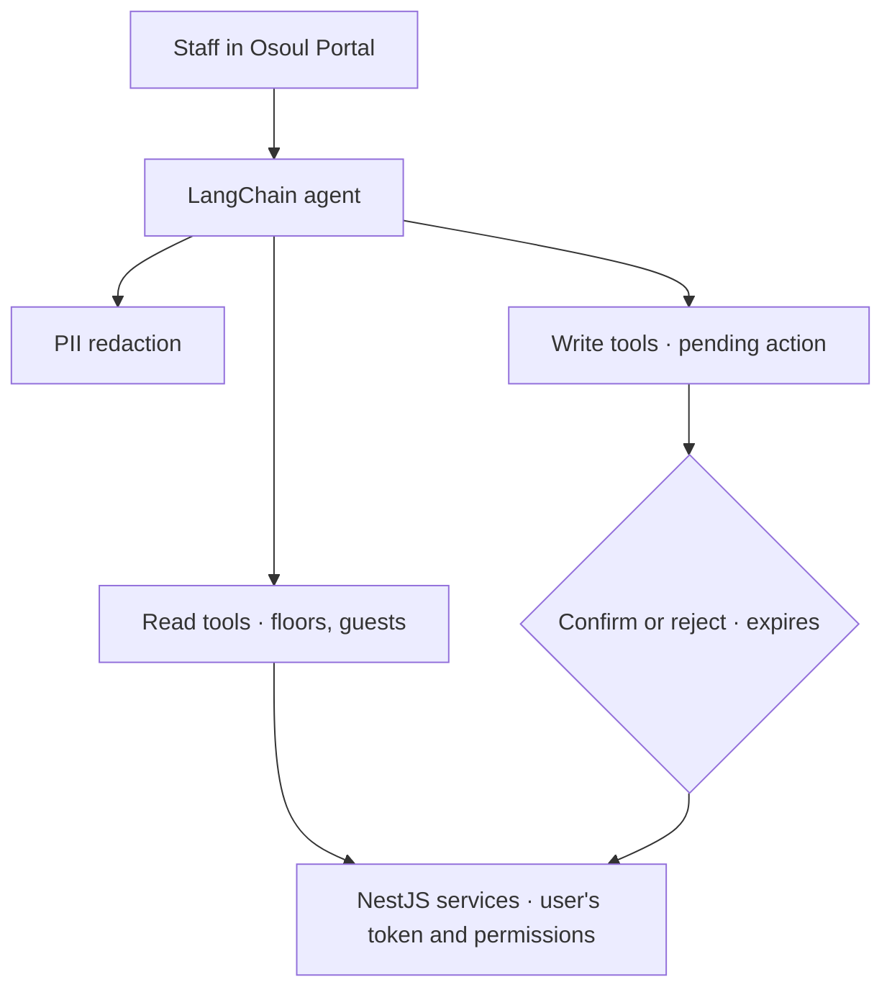

import Gallery from '../../../components/Gallery.astro';
import OsoulAssistantDiagram from '../../../components/diagrams/OsoulAssistantDiagram.astro';

Part of the [Osoul platform](/projects/osoul) case study.

## Problem

Restaurant staff ask questions that cut across the whole platform: which tables are free tonight, has this guest been here before, can you book them for three at ten. An assistant can answer in one sentence what takes five screens, but an assistant with database access is also the easiest way to leak guest data or make changes nobody approved.

## Constraints

- **Same permissions as the person asking**: a host must not see what only a manager may see, just because they asked the assistant.
- **Guest data stays protected**: names, phone numbers and emails should not reach the model unless they must. {/* CHECK: confirm what is redacted and when */}
- **No silent writes**: a reservation or change must never happen because a model guessed.
- **Explainable**: staff need to see what the assistant looked at before trusting its answer.

## Architecture

<OsoulAssistantDiagram> {/* CHECK: diagram claims are partly inferred */}

Diagram source (Mermaid)

</OsoulAssistantDiagram>

<Gallery items={props.media} />

In the screenshot the assistant was asked to book a table. It called `floors.get`, `floors.getFloorObjects`, `floors.getObjects` and `guests.listGuests`, listed the data it used, and drafted `reservations.createReservation` with its payload. The reservation is not created until the user presses Confirm, and the draft shows how long it has left (31 minutes here).

## Key decisions

1. **Tools run with the user's token, not a service account.** A shared service account would let anyone with assistant access read every guest. Propagating the user's own auth to every tool call means the services apply the same permission checks as the rest of the portal, and the assistant can never see more than the user.
2. **Reads are automatic, writes are proposals.** Making every call wait for approval would make the assistant tedious; letting writes through would make it dangerous. Read tools run directly; write tools return a pending action with its full payload, which the user confirms or rejects, and which expires if ignored. {/* CHECK: confirm the expiry rule */}
3. **Tools wrap existing services, not the database.** Giving the agent SQL access would bypass every business rule. Each tool calls the same NestJS service the portal uses, so validation and side effects stay in one place. {/* CHECK: confirm */}
4. **Show the work.** The panel lists the data used and each tool call, so staff can check the answer instead of trusting it.
