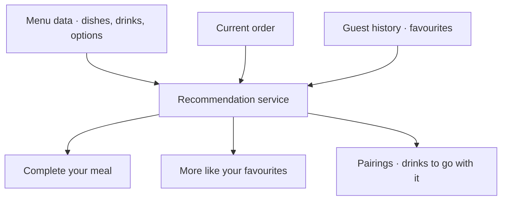

import Gallery from '../../../components/Gallery.astro';
import OsoulRecommendationsDiagram from '../../../components/diagrams/OsoulRecommendationsDiagram.astro';

Part of the [Osoul platform](/projects/osoul) case study.

## Problem

In a fine-dining room the waiter suggests the starter, the wine and the dessert. When guests order from their phone at the table, those suggestions disappear, and so does part of the ticket. Osoul's recommendations put them back in the Guest App, at the moments a waiter would make them.

## Constraints

- **Menus are not catalogues**: dishes have options, add-ons and pairings that change by service and by season. {/* CHECK */}
- **Few signals per guest**: most diners visit a handful of times, so suggestions cannot rely on long histories. {/* CHECK */}
- **Never pushy**: a suggestion that feels like an ad lowers trust in the whole menu.
- **Measurable**: the point is the average ticket, so every surface has to be attributable. {/* CHECK: confirm attribution approach */}

## Architecture

<OsoulRecommendationsDiagram>

Diagram source (Mermaid)

</OsoulRecommendationsDiagram>

<Gallery items={props.media} />

## Key decisions

1. **Model the menu for recommendations first.** A flat list of dishes can only recommend "popular". Pairings, courses and beverage links are part of the menu data, so the service can reason about what completes a meal. {/* CHECK: confirm menu data model */}
2. **Recommend in context, not on a separate page.** Suggestions appear where the decision happens: on the home screen as "complete your meal", and on a dish page as pairings and drinks to go with it.
3. **Start from the order, then the guest.** The current order is the strongest signal at the table; favourites refine it for returning guests. {/* CHECK: confirm signal ordering */}
