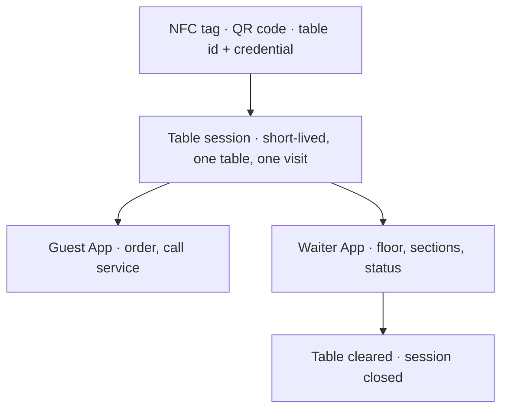

import Gallery from '../../../components/Gallery.astro';
import OsoulTableSessionsDiagram from '../../../components/diagrams/OsoulTableSessionsDiagram.astro';

Part of the [Osoul platform](/projects/osoul) case study.

## Problem

Diners order from their phone after tapping the table, without an account. That makes the table itself the credential: whoever holds a valid link can order to that table. A photo of a QR code, a link shared in a group chat or a guess at a table number must not let anyone order to someone else's bill.

## Constraints

- **No sign-up**: asking diners to create an account before ordering kills adoption.
- **Physical tags are public**: anyone can photograph a QR code, so the code alone cannot be the whole secret.
- **Sessions end with the visit**: an order link must stop working once the table is cleared.
- **Staff see the same truth**: the Waiter App needs to know which tables are seated and for how long.

## Architecture

<OsoulTableSessionsDiagram>

Diagram source (Mermaid)

</OsoulTableSessionsDiagram>

<Gallery items={props.media} />

## Key decisions

1. **A session per visit, not a permanent table URL.** A permanent link would work forever for anyone who saved it. The tap exchanges the tag's credential for a short-lived session token bound to that table and that visit.
2. **Sessions close with the table.** When staff clear the table, the session ends, so a link from lunch cannot order at dinner.
3. **One session, two views.** The Guest App and the Waiter App read the same session, so the floor view shows who is seated and for how long without staff entering it twice.
