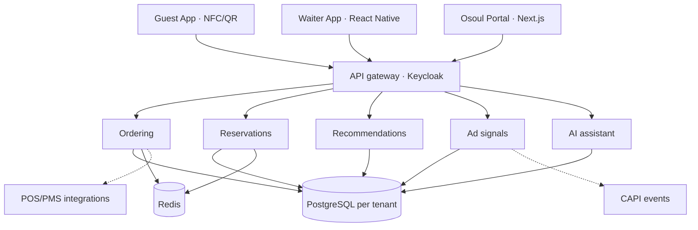

import Gallery from '../../../components/Gallery.astro';
import OsoulDiagram from '../../../components/diagrams/OsoulDiagram.astro';

## Problem

A fine-dining restaurant knows less about its guests than any online shop knows about its visitors. Who booked, who actually came, what they ordered, what they would have added, and why they did not come back: that data is scattered across a booking tool, a POS and paper, or never captured at all. Osoul is Revenue as a Service (RaaS): a growth engine built around specific revenue KPIs, average ticket, no-shows, occupancy and returning guests, that captures this lost data with mature technologies and turns it into moves on those KPIs. Management tools come built in, so the restaurant runs on Osoul rather than beside it.

## Constraints

- **Multi-tenant from day one**: each restaurant's data stays isolated, with its own visual identity and licence.
- **Anonymous diners**: guests order from the table without an account, so sessions must be secure without logins.
- **Existing systems**: POS and PMS stay in place; Osoul integrates with them.
- **Privacy**: guest data feeds ads and an AI assistant, so personal data must be redacted or consented at every boundary.
- **Small team**: one technical founder, so every component has to earn its operational cost.

## Architecture

<OsoulDiagram>

Diagram source (Mermaid)

</OsoulDiagram>

The machinery behind the KPIs, each one its own deep-dive later:

- **[Table sessions](/projects/osoul-table-sessions)**: NFC/QR taps open a short-lived, table-bound session for anonymous diners.
- **Multi-tenant provisioning**: dual-database provisioning with NestJS and TypeORM.
- **[Recommendations](/projects/osoul-recommendations)**: menu data architecture, dish and beverage recommendations, meal-completion promos.
- **Ad signals**: a tracking event schema and server-side CAPI events for ad-audience optimisation.
- **[AI assistant](/projects/osoul-ai-assistant)**: LangChain tools that run with the user's own auth, PII redaction, and confirmation before any write.
- **Diner identity**: reservation and diner profiles merged into one guest record.
- **Reservations and flow control**: deposits, queues, multi-channel reminders and bots, loyalty to smooth peak hours.
- **Operations and revenue**: occupancy and SLA tracking with escalations, event-based dynamic menu pricing, POS/PMS integrations.

<Gallery items={props.media} />

## Key decisions

1. **Table sessions over guest accounts.** Asking diners to sign up before ordering kills adoption at the table. A tap on the NFC tag or QR code opens a session bound to that table and that visit, so ordering takes one step and a leaked link is useless after the meal.
2. **The assistant acts as the user, not as a service account.** A shared service account would let anyone with assistant access read every guest. Instead each tool call carries the user's own auth, so the assistant can see exactly what the user can see, and writes such as creating a reservation wait for an explicit confirmation.
3. **Server-side ad events over browser pixels alone.** Pixels miss ad-blocked and privacy-restricted browsers and leak more than they need to. Events are built server-side against one tracking schema, stripped of what the ad platform does not need, and sent through CAPI.
4. **Database per tenant over a shared schema.** A tenant column in shared tables is cheaper to run, but one missing filter leaks a restaurant's guests to another. Separate databases make isolation structural and let a tenant be exported or deleted cleanly.
