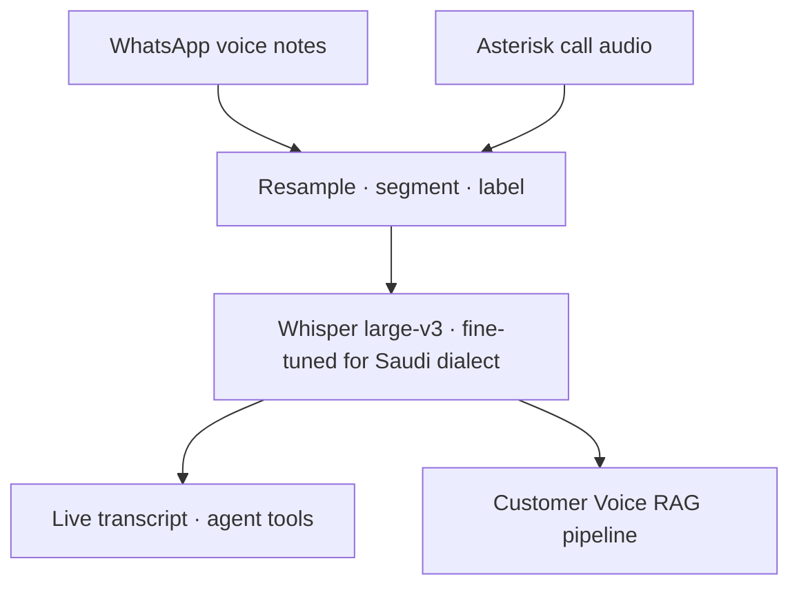

import Gallery from '../../../components/Gallery.astro';
import SaudiSttDiagram from '../../../components/diagrams/SaudiSttDiagram.astro';

## Problem

Contact centres in Saudi Arabia take most of their calls and voice notes in Saudi dialect, not Modern Standard Arabic. Off-the-shelf speech-to-text models are trained mostly on MSA and other dialects, so they drop or mangle exactly the words that matter: order numbers, product names, complaints. Without reliable transcripts there is no search, no analytics, and no voice agent that can act on what the customer said.

## Constraints

- **Dialect and code-switching**: Saudi Arabic mixed with English product terms and numbers. {/* CHECK: inferred, confirm */}
- **Telephony audio**: narrow-band Asterisk recordings and compressed WhatsApp voice notes, with noise and cross-talk. {/* CHECK: inferred, confirm */}
- **Data residency**: government and enterprise clients, so audio and transcripts could not go to a third-party speech API. {/* CHECK: inferred, confirm */}
- **Real time**: transcripts feed a live agent, so latency matters as much as accuracy. {/* CHECK: inferred, confirm */}

## Architecture

<SaudiSttDiagram>

Diagram source (Mermaid)

</SaudiSttDiagram>

<Gallery items={props.media} />

  In the call above the customer says «طلبي للحين ما وصلني» ("my order still hasn't reached me"). The transcript is reliable enough for the agent to call <code>track_order</code> mid-call and answer with the courier status.

## Key decisions

1. **Fine-tune Whisper large-v3 rather than use a hosted speech API.** Hosted APIs were weaker on Saudi dialect and would have sent client audio outside the deployment. Fine-tuning an open model kept audio in-house and let the vocabulary follow the clients' domains. {/* CHECK: inferred, confirm */}
2. **Invest in data preparation before training.** Every source was normalised to the same format, split at speaker turns and labelled, so the model learned the dialect rather than the quirks of each channel. {/* CHECK: hours of audio and labelling process */}
3. **One model for live and offline use.** The same fine-tuned model serves live transcripts for agents and batch transcripts for the Customer Voice pipeline, so improvements reach both. {/* CHECK: confirm serving setup */}
